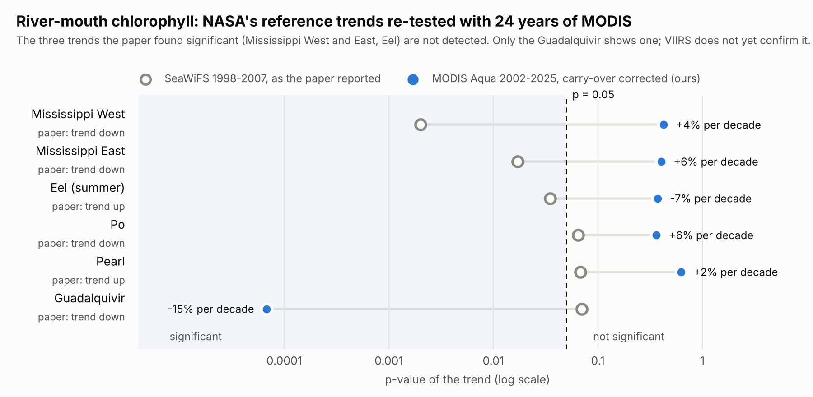
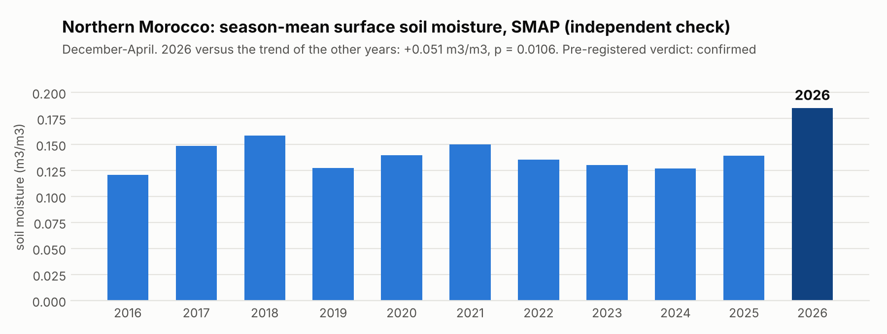
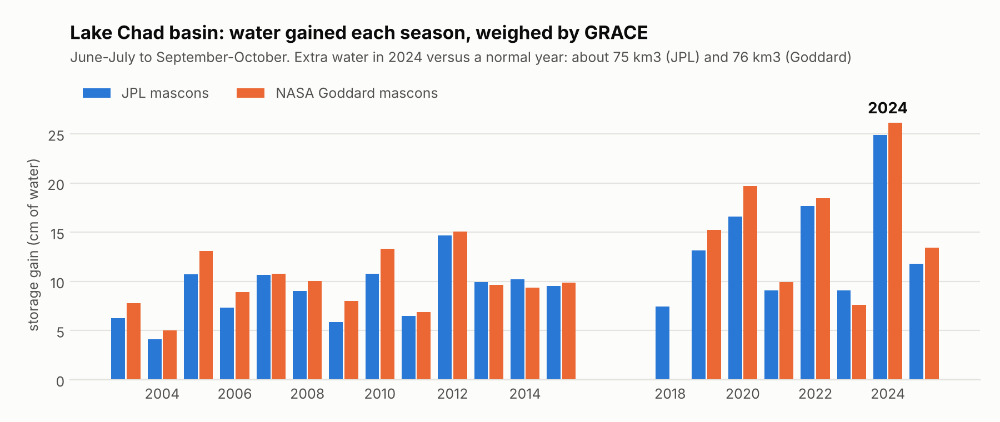
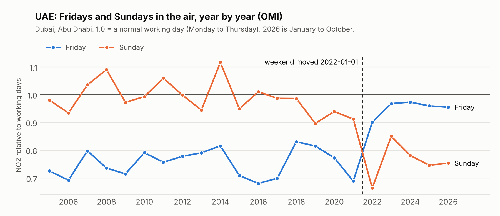
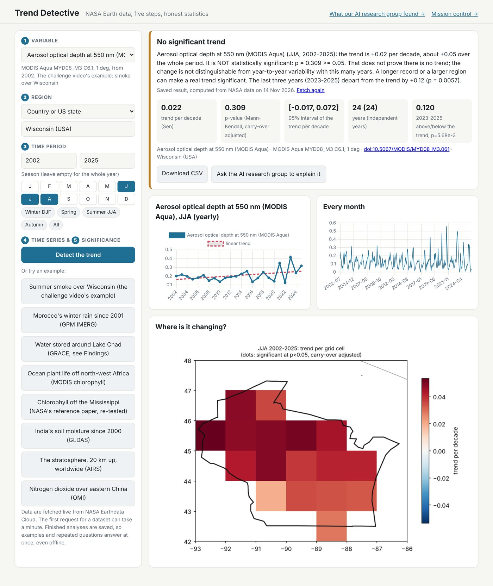
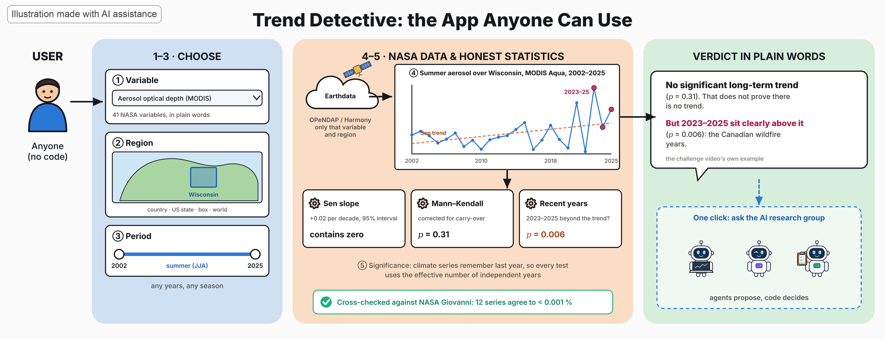
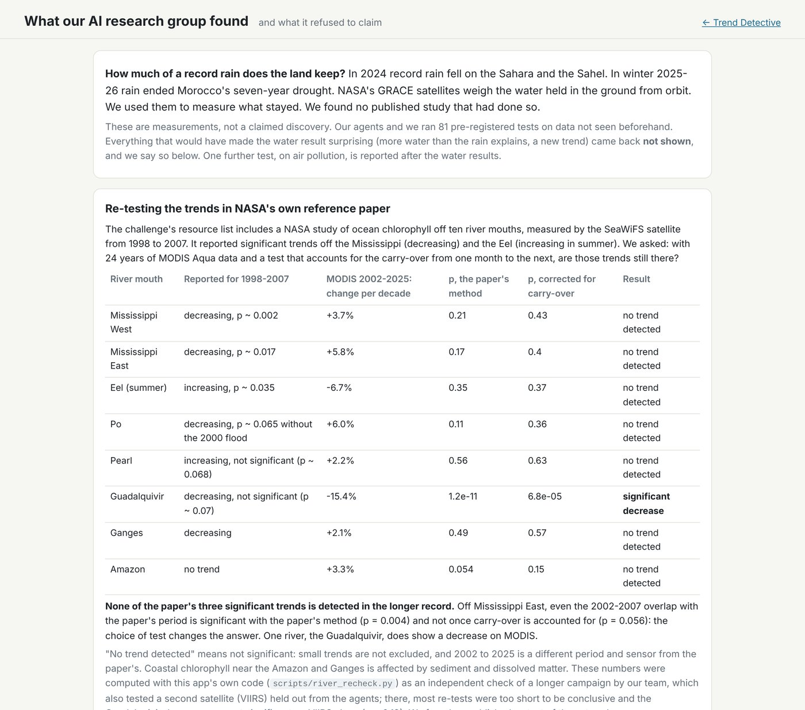
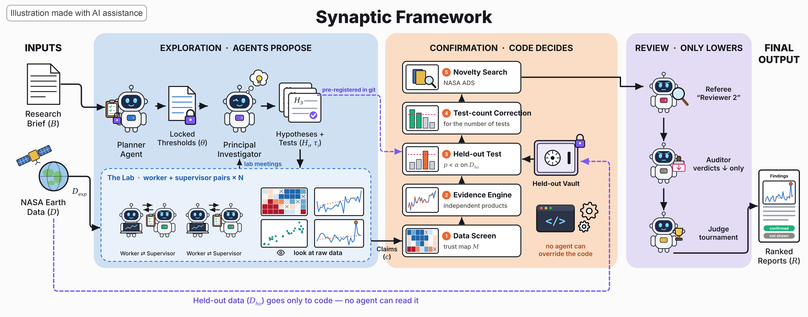
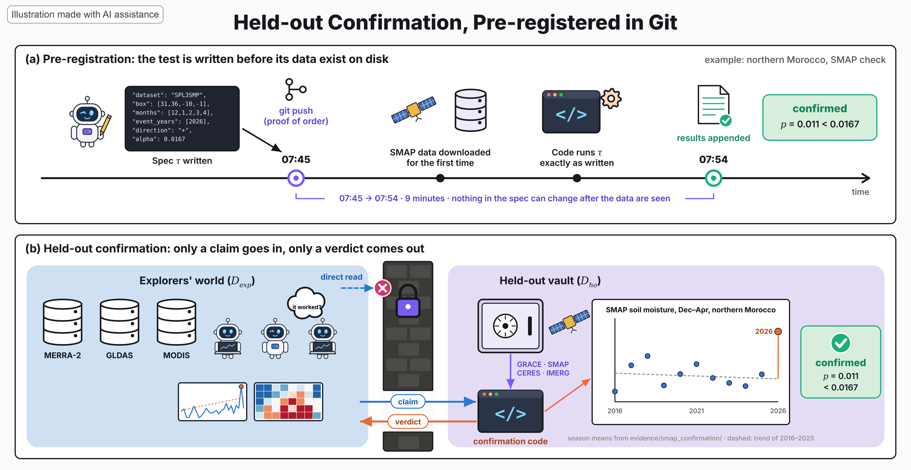
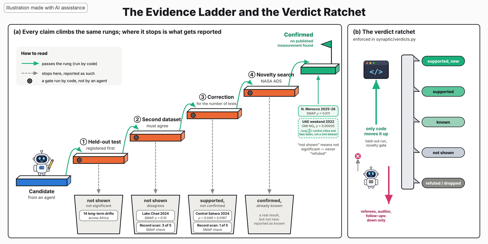

# Synaptic Trend Detective

**Honest trends from NASA Earth data: an app anyone can use, backed by an AI research group that is built to refuse
over-claiming.**

NASA Space Apps Challenge 2026 · Earth track · *Be an Earth System Trend Detective!*


Pick a NASA variable, a region and a period. Trend Detective draws the time series and says in plain words how fast it
is changing and whether that change is statistically real. Behind it, a team of AI agents searched NASA data for
changes. The agents propose; code decides. Every claim below was tested on data the agents never saw, with the test
written down first.

**Team Synaptic** (Casablanca, Morocco): **Nassim Abouelfadile** and **Reda Louriki**

**Links:** [Landing page](https://0x-type.github.io/Synaptic/) ·
[Research paper (PDF)](docs/paper/synaptic_paper.pdf) · [Slides (PDF)](docs/slides/Synaptic_slides.pdf) ·
[Story map (ArcGIS)](https://arcg.is/1uOXai3)

---

## What we found

| | Finding | The proof |
|---|---|---|
| 1 | **NASA's own reference trends, re-tested.** The three river-mouth chlorophyll trends a NASA study reported as significant (SeaWiFS, 1998-2007) are **not detected** in 24 years of MODIS once month-to-month carry-over is accounted for | p = 0.37 to 0.43; two separate versions of our code agree |
| 2 | **Northern Morocco, winter 2025-26.** The rains that ended a seven-year drought put **17 to 21 km³** more water into the ground than a normal winter | GRACE on two independently processed datasets; **confirmed by a second satellite, SMAP (p = 0.011)**, with a test registered before its data were downloaded |
| 3 | **Lake Chad basin and central Sahara, 2024.** The record rains added about **75 km³** around Lake Chad and **46 to 73 km³** in the central Sahara, the largest gains since 2003 | GRACE, two datasets; the SMAP check was "not shown" (Lake Chad) and "supported, not confirmed" (Sahara) |
| 4 | **A human-made change, seen from space.** When the UAE moved its weekend in 2022, the cleanest day in the air over Dubai and Abu Dhabi moved from Friday to Sunday | Daily OMI nitrogen dioxide; registered test, p = 0.00005; four control cities show no change |

We searched NASA ADS and found no published measurement of findings 2, 3 or 4, and no published re-test for finding 1.
We do not claim to be first: we have not read every paper.

### 1 · NASA's reference paper, re-tested with 24 years of MODIS

The challenge's resource list includes a NASA study of chlorophyll off ten river mouths (*Time-Series Analysis of
Remotely-Sensed SeaWiFS Chlorophyll in River-Influenced Coastal Regions*, NTRS 20090042747). It reported significant
trends off the Mississippi (down, at two sites) and the Eel (up in summer). We asked: with MODIS Aqua 2002-2025 and a
test that accounts for carry-over from one month to the next, are those trends still there?



- **None of the three is detected** (corrected p = 0.43, 0.40 and 0.37). All three MODIS trends point the opposite way to the paper's, though none is significant.
- **The choice of test changes the answer.** Off Mississippi East, the 2002-2007 overlap with the paper's period is
  significant with the paper's method (p = 0.004) and not once carry-over is corrected (p = 0.056).
- **One river does show a trend:** the Guadalquivir, about 15% less chlorophyll per decade. A second satellite, VIIRS,
  does not yet confirm it (p = 0.19), so we report it as a lead.
- "Not detected" means not significant over a different period and sensor. Small trends are not excluded.

Evidence: [`evidence/river_chlorophyll/`](evidence/river_chlorophyll) · code: `scripts/river_recheck.py`

### 2 · Morocco's drought break, confirmed by a second satellite

NASA's GRACE satellites weigh the water held in the ground from orbit. After seven dry years, winter 2025-26 added
17 to 21 km³ more water than a normal winter in northern Morocco, on both the JPL and the NASA Goddard solutions.
A GRACE result chosen out of many tests can be luck, so we added a check on a different instrument. We wrote down
the test, pushed it to git, and only then downloaded SMAP soil moisture:



2026 is the wettest December-April in SMAP's record: +0.051 m³/m³ above the trend of the other years,
**p = 0.011, below the threshold of 0.0167 fixed in advance for three tests.** Verdict: confirmed.

Registration: [`docs/preregistrations/1_water_gains_smap.md`](docs/preregistrations/1_water_gains_smap.md) ·
evidence: [`evidence/water_gains/`](evidence/water_gains), [`evidence/smap_confirmation/`](evidence/smap_confirmation)

### 3 · How much of the 2024 Sahara-Sahel deluge did the land keep?



| Where and when | Extra water versus a normal year | Rank since 2003 | Independent SMAP check |
|---|---|---|---|
| Lake Chad basin, 2024 rainy season | about 75 km³ | largest on record | not shown (p = 0.10) |
| Central Sahara, 2024 rainy season | 46 to 73 km³ | largest on record | supported, not confirmed (p = 0.049) |
| Northern Morocco, winter 2025-26 | 17 to 21 km³ | 2nd or 3rd largest | **confirmed (p = 0.011)** |

Around Lake Chad and in the central Sahara, about three quarters of the extra water was still there seven months
later, in the next dry season. These are measurements, not a new mechanism.

### 4 · A secondary result: the UAE's weekend, seen in the air

On 1 January 2022 the United Arab Emirates moved its weekend from Friday-Saturday to Saturday-Sunday. City nitrogen
dioxide (traffic, power, industry) drops on rest days. We registered the test before downloading any OMI data for
these cities, then ran it on 22 years of daily measurements.



Friday went from 24% below a working day to 5% below; Sunday went from 5% below to 24% below. p = 0.00005: none of
20,000 random reshufflings matched it. Dubai
and Abu Dhabi each show it separately. Doha, Tehran, Cairo and Kuwait City show nothing on that date, and fake dates
(2019, 2024) show nothing. The same test passed for Oman and Saudi Arabia (2013), but a control city moved too, so we
do not rely on those two. This is a step in a weekly pattern, not a long-term trend, and not a claim about emissions.

Registration: [`docs/preregistrations/3_weekend_shift.md`](docs/preregistrations/3_weekend_shift.md) ·
evidence: [`evidence/weekend_shift/`](evidence/weekend_shift)

### What we refused to claim

**81 pre-registered tests** in all. Everything that would have made the water results a surprise came back
**not shown**: more water kept than rain minus evaporation explains, slower draining than usual, a darker desert
afterwards, a change in Morocco's winter recharge, and 14 long-term drifts across Africa tested on years no agent had
seen. A worldwide scan for record seasons produced 5 candidates; none was confirmed. The harness twice called a
textbook result "new"; we caught it, fixed the check and logged it.

"Not shown" means not significant. It is never reported as "refuted".

---

## The app: Trend Detective



The challenge asks for five steps. Each one is a control on the page:



- **All six data sources the challenge names:** MODIS, OMI, AIRS, GPM, MERRA-2 and GLDAS, plus GRACE, CERES and MODIS
  ocean chlorophyll. AIRS gives temperature at four heights (1.5 to 20 km) for "levels of the atmosphere".
- **Statistics that do not over-claim.** Climate series remember the previous year, which makes naive tests find trends
  that are not there. Every test accounts for that carry-over and reports the effective number of independent years.
  A separate test asks whether the latest years sit beyond the trend, so one record event is not mistaken for a trend.
- **The challenge video's own example works:** summer aerosol over Wisconsin (MODIS Aqua, 2002-2025) has no
  significant long-term trend (p = 0.31), but 2023-2025 sit clearly above it (p = 0.006): the Canadian wildfire years.
- **Checked against NASA's own tool.** Twelve monthly series fetched through the app and through NASA Giovanni agree
  to better than 0.001% ([`evidence/giovanni_crosscheck`](evidence/giovanni_crosscheck)).
- **Works offline for the demo.** Eight example cases answer at once from saved results.

The **Findings page** (`/findings`) shows every result above with its charts, its registration and the full list of
what was tested and not shown:



---

## The AI research group: agents propose, code decides

Synaptic adapts the method of *Autonomous AI agents discover reverse transcriptases with tandem repeat arrays*
(Yoon et al., 2026) from genome mining to Earth observation. NVIDIA Nemotron models play a research group. The key
design choice: **no agent can promote its own claim.** Agents write hypotheses, analyses and reports; code runs the
tests that decide.





<sub>Figures in this README are illustrations made with AI assistance (PaperBanana style); data charts are plotted from NASA data by code.</sub>

Every claim climbs the same ladder. It can stop on any rung, and where it stops is what gets reported:



Other rules, enforced in code:

- **Agents must look at the data.** Raw numbers and figures go into the (vision) model's context; a worker cannot
  finish a task without it, and the dashboard shows every image an agent looked at.
- **Verdicts only go down** after the confirmation gates (`synaptic/verdicts.py`).
- **Without a NASA ADS token, novelty is "unverified"**, never "new".
- **Agent code runs in a sandbox** with no network and no credentials.

The full description (campaign stages, GPU models on Kaggle, the expert review and what changed, the live tests
with Nemotron) is in [`docs/harness.md`](docs/harness.md).

---

## Check it yourself

Every result in this README is recomputed offline, from data bundled in the repository, by one command:

```bash
python -m synaptic reproduce
```

It re-checks 8 evidence bundles (GRACE water gains, SMAP confirmation, record scan, weekend shift, river
chlorophyll, Giovanni cross-check and two earlier campaign results) and must report 8/8. (The weekend test re-runs
with 2,000 permutations to stay fast, so it reports p = 0.0005, the smallest p that 2,000 can give.)

The order of events is proven too: each confirming test was pushed to git before its data were downloaded. The
commit times are listed in [`docs/preregistrations/`](docs/preregistrations).

## Run the app

```bash
python -m venv .venv && source .venv/bin/activate      # Windows: .venv\Scripts\activate
pip install -r requirements.txt
python -m synaptic setup        # type your free NASA Earthdata token (hidden input, saved to .env)
python -m synaptic dashboard    # open http://127.0.0.1:8050/trend and http://127.0.0.1:8050/findings
```

The eight example cases answer without a network or a token. `python -m pytest` runs the 39 tests.
To run the AI research group itself (NVIDIA API key needed), see [`docs/harness.md`](docs/harness.md#running-campaigns).

## NASA data used

All through one NASA Earthdata login.

| Data | Used for |
|---|---|
| MODIS Aqua: aerosol, clouds (MYD08_M3), sea surface temperature, **chlorophyll** | App; river re-test |
| OMI on Aura: NO2 (OMNO2d), ozone (OMTO3e) | App; **UAE weekend result** (daily data) |
| AIRS on Aqua (AIRS3STM): temperature at 4 heights, water vapour | App |
| GPM IMERG Final V07 | App; held-out tests |
| MERRA-2 reanalysis (GMAO) | App; agents' exploration |
| GLDAS Noah 2.1 | App; agents' exploration |
| **GRACE / GRACE-FO** mascons: JPL RL06.3 and NASA Goddard RL06v2.0 | App; **water findings, on two independent solutions** |
| **SMAP** L3 soil moisture (SPL3SMP) | **Independent confirmation** |
| CERES EBAF | App; held-out tests |
| NASA Giovanni · POWER · GIBS · CMR · ADS | Cross-check · agents' tools · novelty check |

DOIs for each product are listed in [`docs/data_sources.md`](docs/data_sources.md).

## Repository map

```
synaptic/            the app and the harness
  dashboard/         Trend Detective (/trend), Findings (/findings), mission control (Flask + vanilla JS)
  trend.py           the trend statistics (Sen, Mann-Kendall with carry-over, intervals, step tests)
  cloud.py           NASA Earthdata access (OPeNDAP, Harmony) for the app's 41 variables
  harness.py         campaign orchestrator: planner, PI, workers, supervisors, referees, auditor, editor, judge
  confirm.py         held-out confirmation gate      verdicts.py   verdicts can only go down
  verify.py          evidence engine                  reproduce.py  re-checks every evidence bundle
evidence/            one folder per result: data, check.py, expected.json, figures
index.html           the landing page (GitHub Pages)
docs/
  paper/             the research paper (PDF and LaTeX source) and its figures
  slides/            the 7-slide demo (PDF)
  preregistrations/  the tests as registered, then their results
  harness.md         the research harness in detail
  research/          the research log and the harness test report
scripts/             the analyses behind each evidence bundle
synlib/  skills/  briefs/  kaggle_job/  sandbox/   agent library, method guides, briefs, GPU templates, sandbox
tests/               39 tests
```

## Limitations

- GRACE resolves about 300 km. The two GRACE solutions differ on the central Sahara (46 vs 73 km³).
- SMAP sees the top 5 cm of soil and GRACE weighs all water: SMAP confirms that the land was unusually wet, not the
  volume.
- The three GRACE leads came out of 55 tests, so their own p-values do not prove anything; only the registered SMAP
  verdicts are used.
- "Not detected" for the river trends is over a different period and sensor than the paper's; small trends are not
  excluded. Coastal chlorophyll near large rivers is affected by sediment.
- OMI passes at about 13:30 local time; the weekend result is about the weekly pattern, not tonnes of emissions.

## Use of artificial intelligence

1. **Inside the product.** NVIDIA Nemotron models (Nemotron 3.5 Super VL, Nemotron 3 Ultra) play the research
   agents. They propose; code runs every confirming test on data the agents cannot access.
2. **To build the project.** An AI coding assistant (Claude, by Anthropic, through Claude Code) wrote and revised
   parts of the code, ran analyses and the confirmation scripts under the team's direction, and drafted documentation
   and the paper, which the team reviewed. The UAE weekend study was designed and run with Claude under the same
   pre-registration rules.
3. **Figures.** The framework, confirmation, ladder and app illustrations were made with AI assistance (PaperBanana
   style) and are labelled on the image.

No AI-generated video or audio is used. Every data chart is plotted from NASA data by code in this repository,
and no finding rests on an AI model's judgement: `python -m synaptic reproduce` recomputes them all.
