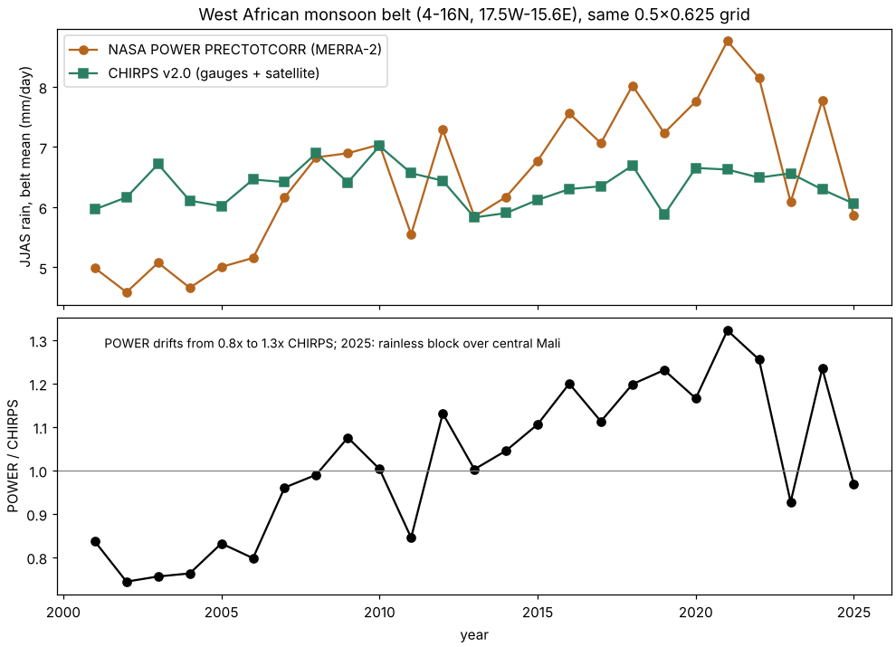
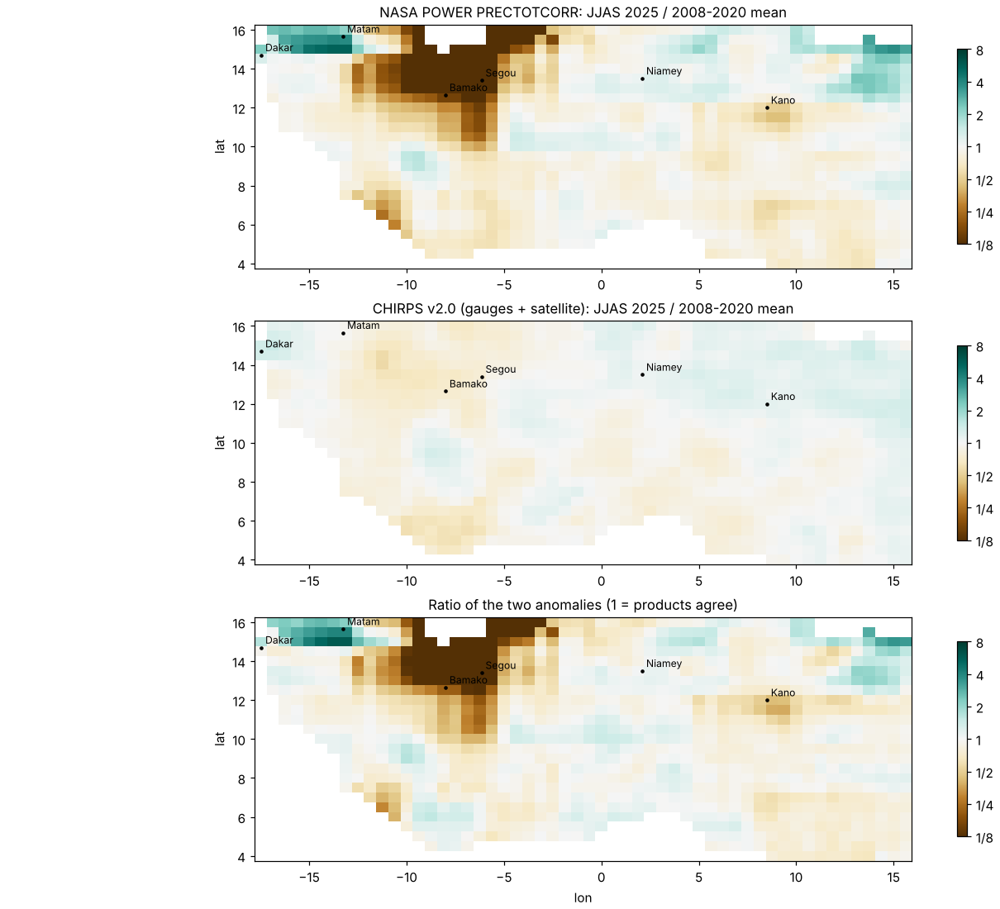
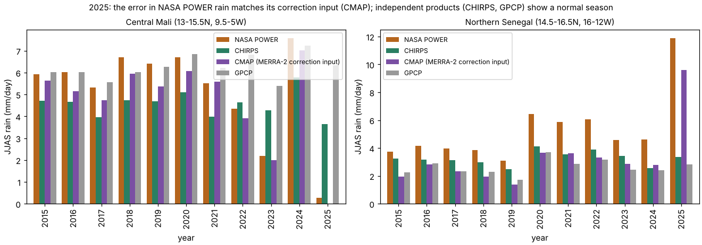

# Synaptic deep test report (15-16 October 2026)

Live testing of the harness with **NVIDIA Nemotron 3.5 Super VL** (`nvidia/nemotron-3.5-super-vl-120b-a12b`) on real
NASA POWER data, the Kaggle GPU queue on a real T4, and an interactive scientific follow-up of the agents' leads.

## 1. Does Nemotron drive the harness? Yes, after tuning

| Live run | Action-format errors | Outcome |
|---|---|---|
| Smoke run 1 (before fixes) | 13 in 55 calls | Stopped: parse loops, planner misread threshold units |
| Smoke run 2 | 8 in 56 calls | Stopped: empty `finish`, supervisor misled by truncated digest |
| **Smoke run 3 (after fixes)** | **1 in ~230 actions** | **PASS**: full pipeline in 34 min; 20 images inspected; 20 follow-ups proposed (7 run, 12 declined by triage); verdict *known phenomenon* (2023-24 Tmax records in 54/62 cells, +2.3 °C vs 1981-2010), which is correct |

### What we learned about Nemotron, and what the harness now does about it

| Observed Nemotron behaviour | Harness fix |
|---|---|
| Drops the final `}` of the action JSON (most common failure) | Parser closes unbalanced brackets (outside strings) before decoding |
| Raw newlines and regex backslashes (`\d`) inside JSON code strings | Tolerant decoding (`strict=False`, escape repair) |
| Extra keys and a stray `}` after `args` | Balanced-object fallback |
| Quotes the instruction example `{"action": "python", "args": {}}` in its text | Parser prefers actions that carry arguments; never executes a quoted empty example |
| Calls `finish` with empty args and writes the report as prose | Prose next to the JSON becomes the summary; a truly empty finish is refused with instructions |
| Full reasoning on worker steps: ~28 s and often hits the 8k output cap **before writing the action** | Per-role reasoning: workers `low` (~8 s, reliable), planner/supervisor/editor/judge `on`; output cap 16k |
| Planner set thresholds in the wrong units (corroboration "2", artifact window "90 days") | Prompt lists units and ranges; harness clamps and records the planner's original value |
| Planner briefs pushed later-stage work onto sweep workers | Stage briefs are labelled as scoped guidance; workers told to stay in scope |
| Supervisor rejected work because the digest truncated outputs | Digest marks excerpts as excerpts and gives data-reading tools longer excerpts |
| Supervisor kept adding new requirements on each revision | On revision N it only checks previous points; remaining gaps become caveats |
| Two parallel campaigns exceeded the API rate limit (HTTP 429) | Shared cooldown across all agent threads, `Retry-After` honoured, rate-limited tasks re-queued |
| Agent scripts on large regions can exhaust RAM | 2.5 GB memory ceiling per agent script (`SYNAPTIC_EXEC_MEM_GB`), with guidance on failure |
| Sweep-stage follow-ups consumed the whole task budget | Survey-stage follow-ups capped at 35% of the budget, reserving room for deep dives |
| Supervisor asked sweep workers for later-stage work (clustering) | Supervisor prompt: judge work against its own stage; later-stage ideas become follow-ups |
| Agents wasted steps hunting for downloaded files | Every task folder gets a `data/` link to the campaign's downloads |
| The test environment killed every process twice (about every 70 min) | **`python -m synaptic resume <campaign_id>`**: interrupted tasks are re-queued and the pipeline continues from the first unfinished stage, keeping all completed work (tested by killing a campaign mid-deep-dive) |

## 2. Infrastructure

- **Kaggle GPU queue: works.** The surprise model was pushed as a private kernel to account `hemingweb`, ran on **2× T4** (`device=cuda gpus=2`) in about 40 s, and outputs were fetched back. Kaggle's JSON log stream is converted to plain text for the agents.
- **Scale: fine.** A 30°×30° region (2,928 cells, 1.6M values) downloads in 26 s and sweeps in about 30 s. Family grouping was rewritten from all-pairs to grid neighbours: **126 s → 0.06 s**, identical results.
- **Literature: improved.** All reachable sources are merged and re-ranked by relevance (place names weigh triple; hits that miss the query's place names are penalised). From the test sandbox, OpenAlex was rate-limited; on a normal connection it, and NASA ADS with a free token, give better coverage.
- **New tool `independent_series`:** box-mean CHIRPS rainfall (1981-2025) or CHIRTS max temperature (1983-2016), so agents can test any POWER signal against independent observations in one call.

## 3. What the agents found on their own (Nemotron, central Morocco)

- **Grid-edge rainfall artifact, proven.** POWER shows 29.9 mm/day in September 2021 at the eastern grid edge (typical < 5). An agent fetched CHIRPS for the same cells and months, found normal values, and rejected the spikes as a grid-edge artifact.
- **Soil-moisture clipping floor.** Root-zone wetness is pinned at exactly 0.45 in about 90% of summer months at four southern cells. The agents showed it is specific to that variable and season, and flagged soil-moisture trends there as unreliable.
- **2016 soil-moisture drop near the Haouz/Tadla.** Opened as a follow-up; the interactive check (section 4) explained it.

## 4. Interactive investigation (Claude, following the agents' leads)

1. **Tadla/Haouz soil drying after 2016: explained, not new.** The drop beyond same-season rain (about −1.4 SD) shrinks to about −0.25 SD once soil memory of the previous 6-36 months of rain is modelled. It is the stored effect of Morocco's multi-year drought.
2. **Sahara/Sahel ~2000 jumps in Tmax: mostly real.** In a homogeneity test against CHIRTS, most families agree between products (e.g. +0.96 vs +1.05 °C), so the aerosol-artifact hypothesis was rejected for them.
3. **Candidate discovery: NASA POWER rainfall over northern Nigeria drops ~30% in 1999 with no matching change in independent observations.**
   - May-October rainfall: POWER −26.5% (break 1999, p = 0.002) vs CHIRPS +4.2% (no break). The POWER/CHIRPS ratio breaks in 1999 (p = 0.001).
   - Footprint: 64 of 1,188 wet West African cells show a field-significant break in the ratio, 41 of them in 1999. Main cluster: 32 connected cells around 11.3°N, 9.3°E (Kano, Kaduna, Bauchi), about 120,000 km².
   - The same cells show simultaneous 1999 breaks in soil wetness (−2.5 SD), humidity (−5.9 points) and Tmax (+1.7 °C). The Tmax step is +2.0 °C in POWER vs +0.7 °C in CHIRTS (difference breaks in 9/9 cells).
   - Status: **candidate data inhomogeneity for expert review.** Not yet settled which product is wrong; station records (NiMet, GHCN), GPCC/ERA5 and MERRA-2's precipitation-correction inputs are the next checks. The literature search found no description, but OpenAlex and ADS were unreachable, so novelty is provisional.
   - Why it matters: NASA POWER is widely used for crop and evapotranspiration modelling in Nigeria.

## 5. Blind test: can the autonomous agents rediscover it?

A Nemotron campaign was launched over the West African monsoon belt with a generic brief (no mention of Nigeria,
1999 or rainfall artifacts): `briefs/west_africa_monsoon.yaml`. Result: see section 6.

## 6. Blind test result: the autonomous agents rediscovered the 1999 rainfall inhomogeneity

Campaign `c_177aeb29` (Nemotron, generic West Africa brief, no hint). What the agents did on their own:

1. **Sweeps:** 5 variables over 1,350 cells; the rainfall sweep found 593 cells with significant change points.
2. **They noticed the anomaly.** A soil-moisture worker proposed a follow-up to test whether "1998-2004 changepoint
   clustering" appears in the other variables. The follow-up found that 82% of significant Tmax breaks and 73% of
   Tmin breaks fall in 1998-2004.
3. **They tested it against independent data.** A follow-up ("Cross-check 2001 change-point pile-up against
   independent precipitation") chose CHIRPS, rejected GPM/GPCP because they start too late, and probed a box over
   central Nigeria (8-10N, 6-10E). It then built the POWER-minus-CHIRPS difference over the belt:
   **before 1999 POWER > CHIRPS in 18/18 years (+0.49 mm/day); 1999-2007 POWER < CHIRPS in 8/9 years
   (-0.21 mm/day); t-tests p < 0.001.** Its verdict: the 2001 change-point pile-up in POWER rainfall is a
   **data-production artifact, not a climate shift**, and those cells should be excluded from climate
   attribution. The supervisor accepted.
4. **They went for the footprint and the mechanism.** New follow-ups: "Map the POWER-CHIRPS difference break
   across the regional cell sweep" and "Identify a MERRA-2 production change near 2007-2010 affecting
   PRECTOTCORR and GWETROOT".

**Where the agents fell short:**
- They attributed the break to the SRB->CERES solar switch, which cannot affect MERRA-2 rainfall; the supervisor
  did not catch it. Fixed in the artifact guide and the supervisor prompt.
- They could not map the break per cell because `independent_series` returned only box means. That is a
  tool limitation, now fixed with `per_cell=True`.

**Verdict:** the harness reproduces the paper's pattern. Agents noticed an anomaly beyond their brief, opened
their own follow-ups, tested it against an independent database, and correctly classed it as a data artifact.
The interactive investigation then localized it to northern Nigeria and traced its effect on temperature.

## 7. Deep-dive stage: what broke, and what the harness now does about it

The blind campaign was followed through classification (321 families), census (8 promoted under the locked
filters) and deep dives. This exposed the failure the paper warns about most: **over-claiming novelty**.

| Observed | Harness fix |
|---|---|
| The first four deep dives (Tmin trend, Tmin recent extreme, Tmax trend, Tmax recent extreme) all set `new_signal` for region-wide warming. One did so while reporting that significance **disappears** after autocorrelation correction | **Novelty gate** in `set_verdict`: `new_signal` needs 2+ literature searches and a `novelty_basis`; warming trends / heat extremes are "documented by default" and get an extra check |
| From the test sandbox only Crossref answered, and it returned off-topic hits (Sahel coups for a Sahel temperature query). Agents read "nothing relevant found" as "new" | Hits with no topical overlap are dropped; the tool prints **COVERAGE WEAK** and says that an empty search is not evidence of novelty |
| Supervisors accepted these verdicts | Supervisor prompt checks novelty claims and place names (an agent had placed 5-8N, 8-12E in Ghana) |
| Nothing re-checked a verdict before it reached the report stage | **Verdict auditor**: a new skeptical role re-reads every `new_signal` against the agent's own numbers before reports are written, and downgrades it when the evidence says so |
| Nemotron put a stray `'` after the closing quote of a long code string, and wrote unescaped `"` inside code. A deep dive failed after repeated parse errors | Parser repairs both slips (both failed replies now parse) |
| Triage counted **declined** ideas against the 60-task budget, so every deep-dive follow-up was rejected ("budget reached") with only 36 tasks run | Only real tasks count. Ideas declined for budget are no longer treated as precedent for "duplicate" (the triage model was rejecting good follow-ups as duplicates of declined ones) |
| `family_info` listed only 80 of 356 cells and the agent could not rebuild the family | The full cell list is saved to a CSV in the task folder |
| A STOP during a stage marked the stage "done", so `resume` would have skipped queued deep dives | The stage stays open; the pipeline stops cleanly after every stage |
| Follow-ups inherited the family and were *forced* to re-record its verdict, so a narrow boundary check could overwrite a deep dive's conclusion (one family's verdict changed 6 times) | Only deep dives must record a verdict. The auditor now reads the **whole verdict history** of each family and decides the final verdict, noting that a narrow follow-up does not overturn a broad result |
| 12 follow-ups stalled at the step limit, often blocked only by a process gate, and their work was lost | Three steps before the limit the worker is told exactly what is still missing. A finish at the limit with a real report is kept, with the unmet checks written into it for the supervisor |
| A report the supervisor never accepted (after 3 revisions, mostly on wording) was dropped silently | Filed as **[Draft]** with the supervisor's last objections attached, so humans see it |
| Agents asked for station validation (GHCN/GSOD) and had no tool for it | **New tool `station_series`**: NOAA GHCN-Daily station monthly means (TMAX, TMIN, PRCP, to the present), each station tagged with its POWER grid cell |

**After the fixes**, the next deep dives behaved as the paper describes good practice:
- GWETROOT recent extreme: CHIRPS, 20 GHCN stations (new tool) and three literature searches flagged as weak coverage. Verdict **known_phenomenon** (Sahel rainfall recovery), "novelty provisional".
- RH2M 2007-2010 shift: known_phenomenon for the broad recovery. The supervisor refused to close it until a production-change check was done (stalled after 3 revisions rather than passing weak work).
- **PRECTOTCORR 2008 step (western Sahel): not_robust.** POWER JJAS rain rises +3.8 mm/day (+45%) in 106 cells. At the same cells CHIRPS shows no step (+0.15, p = 0.89) and the POWER-minus-CHIRPS difference breaks (p = 0.0001). The agent refused to call it climate.
- GWETROOT trend: known_phenomenon, noting POWER-CHIRPS rainfall breaks after ~2006.

## 8. New candidate findings (interactive follow-up of the agents' leads)

The PRECTOTCORR deep dive pointed at a drift between POWER and CHIRPS rainfall. Following it up with the new station
tool and CHIRPS on the POWER grid (1,120 wet cells, 2001-2025):

1. **POWER rainy-season rain drifts upward against independent observations.** Belt-mean JJAS rain in POWER rises
   from 4.91 to 7.79 mm/day (+59%) between 2001-06 and 2016-22. CHIRPS goes from 6.24 to 6.43 (+3%). The POWER/CHIRPS
   ratio climbs 0.79, then 1.02 (2008-15), then 1.21 (2016-22): +26% per decade, Kendall p = 1e-7. It rises in 89%
   of cells. GHCN gauges agree with CHIRPS: the POWER/station ratio rises at 14 of 16 West African stations with
   rainy-season records. Published evaluations of MERRA-2 over West Africa (to 2016) rate it well and note only
   that reanalyses overstate trends in general. The size and the post-2016 acceleration appear undocumented.
   
2. **2025: the rainy season is missing from NASA POWER over central Mali.** Over a block of about 42 cells around
   Ségou and Bamako (13-15.5N, 9.5-5W, ~200,000 km²), POWER JJAS 2025 rain is **0.11 mm/day**. CHIRPS gives 3.62
   mm/day, near normal, and FEWS NET reports no severe failure (cereal output slightly up). The block has
   rectangular edges. At the same time northern Senegal gets 4-8x its normal rain in POWER (Matam: June 35 mm/day
   in POWER, 2.4 at the station). The error propagates through MERRA-2's land coupling: in the block, 2025 JJAS Tmax
   is +5.1 °C (z = +6), relative humidity −26 points (z = −10), root-zone wetness z = −4.3.
   Anyone using POWER for 2025 crop, drought or heat work in Mali would see a catastrophic drought and heatwave that
   did not happen.
   
3. **Mechanism for 2025: traced to the input.** Over Africa, MERRA-2 replaces its land rain with the NOAA CPC
   CMAP satellite-gauge product, rescaled to GPCP (Reichle et al. 2017, J. Climate). **CMAP itself has the same
   error.** Its JJAS 2025 value is 0.01 mm/day over central Mali, and four 2.5° boxes have exactly 0.0 in July. Over
   northern Senegal it gives 9.6 mm/day against a normal of about 3. Meanwhile **GPCP shows a normal season** (6.35
   and 2.81 mm/day), and so does CHIRPS. 2023 shows the same pattern on a smaller scale: CMAP 2.0 and POWER 2.2,
   against CHIRPS 4.3 and GPCP 5.4. The error chain is CMAP (input) → MERRA-2 corrected precipitation (applied in
   full over Africa) → NASA POWER PRECTOTCORR → simulated soil moisture, humidity and temperature. No public note of
   this CMAP or POWER error was found. Next checks: MERRA-2 PRECTOTCORR from GES DISC (Earthdata login), the CMAP
   2025 pentads, and Malian station data for 2025. The slower post-2000 drift (item 1) is **not** explained by CMAP's
   belt mean, which drifts only +5%/decade against GPCP, so its origin is still open.
   
4. **Recent Tmax divergence (weaker).** Month-matched against GHCN, POWER Tmax at inland Nigeria and Cameroon
   stations runs warmer than the stations from 2023 (Minna: +0.3 to +0.9 °C in 2019-22, then +1.6, +2.5 and +4.5 °C
   in 2023-25). Coastal stations show no change. Station gaps are large, so this is a lead, not a finding.

**Status:** candidate data-quality findings for the NASA POWER / GMAO teams. Nothing is published as a discovery
until checked against MERRA-2 itself and against national station networks.

## 9. Final outcome of the blind West Africa campaign (`c_177aeb29`)

**Scale:** 8.5 hours wall-clock, 371 agent sessions, about 120 agent-hours of agent time, 48.7 M tokens, 1,854
worker actions. 61 tasks ran: 5 sweeps, classify, census, 8 deep dives, 45 agent-opened follow-ups (101 more
proposals were declined by triage) and 2 reports. The run was resumed 8 times, after environment kills and after
restarts to load fixes; no completed work was lost. 54 worker errors (format or step budget) in 1,854 actions:
about 1 in 34, against 1 in 230 in the short smoke run, because long deep-dive scripts are harder to emit as JSON.

| Family (promoted under locked filters) | Deep dive said | Follow-ups found | Final (auditor) |
|---|---|---|---|
| T2M_MIN recent extreme (932 cells) | new_signal | 13 GHCN stations: none show the ~2001 step | **not_robust** |
| T2M_MIN trend (790 cells) | new_signal | 56 GHCN stations: same trend (+0.25 vs +0.24 °C/decade, r = 0.83, no break in the difference) | new_signal (auditor), see note |
| T2M_MAX recent extreme (356 cells) | new_signal | Real member cells warm only +0.9 °C; no 2020-22 break in any cell; Douala station: no break | **not_robust** |
| T2M_MAX trend (286 cells) | new_signal | 39 stations and CHIRTS agree on warming; significance collapses after autocorrelation correction | **known_phenomenon** |
| RH2M shift 2007-10 (279 cells) | known_phenomenon | (supervisor demanded a production-change check; stalled) | known_phenomenon |
| GWETROOT recent extreme (157 cells) | known_phenomenon | Sensitivity tests; Sahel recovery | known_phenomenon |
| PRECTOTCORR shift 2008 (106 cells) | not_robust | CHIRPS and GPCP show no step; one follow-up said artifact | **not_robust** (no production cause shown inside the campaign) |
| GWETROOT trend (63 cells) | known_phenomenon | Its 2009 step is mirrored in POWER rain but absent in CHIRPS and GHCN | **artifact** (data-production problem in POWER/MERRA-2) |

**What this shows about the method.** All four early over-claims of novelty were taken back by the agents
themselves once follow-ups brought in independent data. That is the paper's self-correction loop working:
follow-ups, independent databases, and a skeptic before reporting. Two reports were filed (T2M_MIN trend, and a
**[Draft]** report on the GWETROOT artifact) and ranked in a 2-game tournament.

**Honest caveats.**
- The auditor kept `new_signal` for the T2M_MIN trend because no gauge or product contradicts it and humidity and
  rain are flat. Station studies already document warming of West African minimum temperatures (e.g. Moron et al.
  2016, *The intensification of thermal extremes in West Africa*). We regard it as a **well-corroborated known
  phenomenon**, not a discovery. The literature indexes the agents could reach were too weak to catch this, which
  is why a free NASA ADS token matters in real use.
- The judge showed **position bias**: each report won the game in which it was shown first (1-1). With so few
  reports the ranking means little. Larger campaigns, or a stronger judge model via `SYNAPTIC_MODEL_JUDGE`, are needed.
- The real discoveries of this test are the data-quality findings in section 8. The agents opened the path, and
  the final tracing (CMAP → MERRA-2 → POWER) was done interactively.

## 10. Bottom line

- **Does the harness work with Nemotron?** Yes. One unattended campaign went from brief to ranked reports:
  sweeps, families, pre-registered filters, deep dives, 45 agent-opened follow-ups, an audit, reports and a
  tournament. Format slips still happen in long scripts. The parser repairs most of them, and the ones it cannot
  cost a retry; one task was lost before the parser fix.
- **Does it find things?** The agents rediscovered blind a rainfall inhomogeneity in a NASA product (Nigeria 1999).
  They refused to call a 2008 rainfall step "climate", and that lead uncovered a previously unreported 2025 error in
  NASA POWER rainfall over Mali, traced to its CMAP input. They also flagged a POWER/MERRA-2 soil-moisture artifact
  (GWETROOT 2009).
- **What it is not yet:** a source of published discoveries without human review. It is a fast way to put
  well-evidenced, falsification-tested candidates in front of NASA scientists, data-quality problems included.

## 11. East Africa deep research campaign (`c_c6b3edcb`, 16 Oct 2026)

A five-part research programme (`briefs/east_africa_audit.yaml`) on 2,928 cells x 5 variables x 540 months, budget
120 tasks, Nemotron 3.5 Super VL. About 12 hours, 100+ completed tasks, 160 M tokens.

**What it established (all confirmed against several independent datasets):**
- A 1997/98 break in NASA POWER over East Africa: rain, root-zone soil moisture and humidity step drier, strongest on
  the Congo-basin side. CHIRPS over the whole grid shows zero FDR-significant cells; GHCN stations, ESA CCI and
  homogenization agree. An extra +0.8-1.0 C Tmax step comes on top of about +0.5 C of real warming (Berkeley Earth,
  1997-98 El Nino). The dry-bias -> warm-bias link was proven cell by cell and year by year (62 of 75 cells, every
  season, strongest June-August).
- Gap fills: years of exactly-zero rain at the Yemen edge (2007-10), deep-soil values frozen in the Sudan desert
  (January-June 2024); a false record rain month near Mtwara (April 2020); suppressed year-to-year Tmax variability
  that turns 89-95% of POWER "recent heat extremes" into false positives.
- Real and known: the 1997-98 warming step; 2023-25 warming. The East African paradox re-test was inconclusive.

**Verified afterwards with raw MERRA-2 (Earthdata token):** POWER equals MERRA-2 to two decimals for the Congo cell
cluster 1990-2005 and for the Mali 2025 block. The errors are in the reanalysis (its rain correction input, CMAP,
documents "an artificial downward trend after 1996"), and NASA POWER passes them on faithfully.

**The problem it exposed:** almost the whole budget went into proving that the data were broken. The paper's agents
worked on primary observations; reanalysis output contains its own breaks, which are the first "anomalies" any
search finds. Science (drivers, mechanisms, predictability) barely started, and the GPU was never used.

## 12. Version 2: science first

| Change | Effect |
|---|---|
| **Automatic data screen** before any agent (`synaptic/screen.py`): POWER vs GPCP and Berkeley Earth, gap fills, suppressed variability, propagation of rain failures to soil/humidity/temperature, known-issues registry | Reproduced the East Africa campaign's main data findings in **66 seconds** (1998 rain and Tmax breaks, Yemen zero runs, bad months). Families inside untrusted data are closed automatically and never promoted |
| **Known-issues registry** (`synaptic/known_issues.yaml`) | Everything confirmed once is never re-investigated |
| **GPU coupling model run by the harness** (`kaggle_job/coupling_model.py`, `synaptic/learn.py`) | One network learns all trusted cells from all variables and ENSO/IOD/Atlantic/PDO/NAO; East Africa: 2,928 cells trained on 2x T4 in under 2 minutes with early stopping; first leads: Indian Ocean Dipole -> rain influence stronger after 2003 in 55% of cells, ENSO -> Tmax stronger |
| **Science stage** with `climate_index` and `record_finding` | Every real signal and GPU lead gets a task on drivers, mechanism, predictability, impacts, novelty |
| **Triage with work kinds** | science / verification (capped at 15%) / housekeeping (refused); leads on closed artifacts are not reopened |
| **`merra2_series`** (Earthdata) | Agents can tell POWER-processing problems from reanalysis problems in minutes |
| Fixes from the run | candidates keyed per campaign (a new campaign was overwriting an older one's families); context budget per agent (a session passed Nemotron's 1M-token window); supervisors accept blocked datasets as caveats; elevation correction for highland stations; disk cleanup of raw downloads after each task |

New science-question brief: `briefs/east_africa_science.yaml`.

### Live check of version 2 (Nemotron, central Morocco smoke test, 16 Oct 2026)

PASS, in about 1 h 55 min. Every new stage ran with the live model:
- **Data screen: 2 s.** Census applied the data-quality rule; the promoted family had 37% of cells in untrusted data,
  under the 50% closure limit.
- **GPU model on Kaggle: under a minute.** Lead: the Indian Ocean Dipole's influence on rain changed after 2003.
- **Triage** labelled every follow-up. It released 4 and refused 20, citing the trust map and the verification cap.
- **Science tasks** used `climate_index` and `merra2_series` and recorded findings with `record_finding`:
  - drivers of summer heat: TNA r = +0.57 and PDO r = -0.63 (p < 1e-4);
  - impacts: months above 40 C rose from 0.3 to 1.7 per year;
  - land coupling: the dry-soil / daytime-heat link strengthened, r = -0.35 -> -0.62 after 2003.
- **Caveat:** the GPU lead's "sign reversal" of the IOD-winter rain link rests on weak correlations (+0.21 -> -0.16).
  It is a lead, not a finding; the soil-heat coupling change is the stronger result.

## 13. Global campaign with NASA's own archive (`c_08cda804`, 17 Oct 2026, version 2)

The first whole-Earth run: 540 monthly MERRA-2 files per collection read from GES DISC with the Earthdata token,
averaged to 3,631 land cells (2 x 2.5 degrees, 60S-80N), 1981-2025; rain, temperature, humidity, root-zone soil
moisture, evaporation. Stopped after 7 h, at the start of the deep dives, to build version 3.

- **Screen:** MERRA-2 rain vs GPCP breaks in 806 cells (2003-2005 dominant), temperature vs Berkeley Earth breaks in
  988 cells (2005-2007); 568 of 1,722 anomaly families later closed automatically as data artifacts.
- **GPU (Kaggle 2x T4, 3.8 min):** ENSO -> temperature influence stronger after 2003 in 60% of 2,425 cells;
  forecast skill: soil moisture 0.76/0.72, temperature 0.25/0.29, rain 0.12/-0.02 (early/late).
- **Agents, verified against independent data in one task each:** Myanmar 2009 rain step = MERRA-2 rain-correction
  artifact (CHIRPS flat; corrected minus raw MERRA-2 jumps +6.2 mm/day); New Zealand 1997 drying = artifact; Amazon
  "2001" drying = 2004 MERRA-2/CHIRPS inhomogeneity; Mindanao 1999 wetting real (CHIRPS + Zamboanga station) but
  inflated 4x by the correction; southern-Amazon dry-season decline real and driven by fewer wet days and later onset
  (rediscovers Fu et al. 2013); 15 of 16 co-located evaporation/rain shifts at the 1997-98 and 2015-16 El Ninos.
- **Harness problems found live:** 13 of the first 20 follow-ups were single-cell verifications; the census promoted 3
  families on the same Brazilian cells; region labels were guessed wrongly ("southern South America" for central
  Brazil, "southeast Alaska" for James Bay); agents trusted knowledge-base notes saying GLDAS was unavailable after it
  was added; a supervisor rejection of the classify write-up dropped the step without revision (a rejected census
  would have created no deep dives); one agent's regional download replaced the global rain table in the data index.
  All fixed; the last three during the run, the rest in version 3.
- New tool during the run: `nasa_series` (GPM IMERG V07 rain 1998-2025; GLDAS Noah 2.0/2.1 soil moisture,
  evaporation, transpiration, runoff 1948-2025), ~740 MB cached in 9 minutes.

## 14. Version 3: a senior research group

| Change | Why (what v2 did) |
|---|---|
| **PI agent + hypothesis board**: 6-10 falsifiable hypotheses with pre-registered tests and kill criteria, written from the brief, the screen and the GPU results; tests run on reserved worker slots **in parallel with the survey**; lab meetings kill dead ends, order deeper tests and add hypotheses | v2 chased the largest anomalies; question-driven science only started after 7+ hours |
| **Evidence engine** (`synaptic/verify.py`) at the census: same statistic in GPCP, IMERG, Berkeley Earth, GLDAS 2.0/2.1 with a difference-series break test; robustness suite; Livezey-Chen field significance with spatial correlation kept; GeoNames place names; Jaccard merging of families on the same cells; ranking by independent support and robustness | v2 spent most follow-ups on these checks one family at a time |
| **Reviewer 2**: an independent referee agent recomputes and attacks every supported claim (3+ real checks required) | claims were only checked by their own author and the supervisor |
| **GPU coupling v2**: 5-fold cross-fitting (every year out of sample), year-bootstrap CIs, event-strength control, 15-year windows, 10-degree blocks; new agent templates `teleconnection`, `causal`, `predictability` that prepare the campaign data themselves | "stronger after 2003" could be just more strong El Ninos after 2003; agents never used the GPU on their own |
| **Trusted tables** (`data/trusted_<VAR>.csv`) | agents re-implemented the trust filter in every task |
| **Outputs**: results page and NASA data-issues report written at the end of every campaign (`synaptic export`) | results were only in the dashboard |

Replaying the v2 global census through the evidence engine (offline, 4 minutes): 334 families pass the basic filters,
they merge into 280 distinct signals; 14 are closed as MERRA-2-only (GPCP and/or IMERG contradict, e.g. the Canadian
Arctic rain step of 2005 that v2 had promoted to a deep dive, with difference-series breaks in 2005 against both);
8 fail the robustness suite. Families now carry place names such as "near Obo, Central African Republic; cells by
country: DR Congo 28, Sudan 21, Chad 16".

Offline checks: the planted teleconnection change (driver influence 0.2 -> 0.8 after 2003) is recovered by the
cross-fitted model (change +0.20, CI [0.16, 0.24], survives the event control); the causal template's first version
showed spurious "new links" in cells whose record the trust mask had cut, so cells need 60% of their months in each
period (and 8 valid years in the teleconnection and coupling templates).

## 15. Global campaign with version 3 (`c_f0cb099c`, 17-18 Oct 2026)

All land 60S-80N, 3,631 cells, 1981-2025, five MERRA-2 variables; 6 workers; Nemotron 3.5 Super VL; Kaggle 2x T4;
Earthdata (MERRA-2, GPM IMERG, GLDAS). About 18 hours including four planned restarts (to apply fixes found live)
and one machine reboot; 836 agent sessions, 200 agent-hours, 99 M tokens, 5 GPU jobs, 112 agent tasks done,
15 reports and dossiers, a 60-game ranking tournament, results page and NASA data-issues report written automatically.

**Research programme (PI).** 19 hypotheses, all falsifiable with pre-registered tests and kill criteria, written from
the brief, the data screen and the GPU model, tested in parallel with the survey from hour one. Outcome: 15 refuted,
2 known, 1 inconclusive, **1 supported and new (pending expert review)**. 10 lab meetings; 8 referee reports.

**Main result.** The influence of December-February ENSO on the following June-August near-surface temperature over
western southern Africa (Namibia, Botswana, western South Africa) strengthened around 2007-2009: per-cell detrended
correlation change +0.13, 95% CI [0.08, 0.17], 44/52 trusted cells (binomial p = 2e-7); box correlation about
0.05 -> 0.4. Robust to dropping the strong El Ninos, to event matching and amplitude matching (it is not more strong
events in the late period), to a different period split, and to a MERRA-2 break test at the period boundary.
Replicated in GHCN stations alone (stronger: +0.69). Mechanism: spring root-zone soil moisture controls winter heat in
the west (r -0.05 -> -0.5/-0.66). Impact: in El Nino years the share of hot winter months rose from 8.3% to 17.4%
(logistic interaction p < 0.001). Not a forecast tool: leave-one-year-out skill did not improve. Two independent
referees upheld it; literature searches (OpenAlex, Crossref, DOAJ, Europe PMC) and a manual web search found no study
reporting it; novelty still needs an expert / NASA ADS check.

**Other results.** Amur basin (Russia/Heilongjiang) +19% rain step in 2009, in raw MERRA-2 and GPM IMERG, weak in
CHIRPS, referee-upheld. Fennoscandia root-zone soil-moisture drop in 1992, also in GLDAS 2.0 (no break in the
difference at 1992; a later difference break near the 2000/2001 MERRA-2 stream boundary), referee-upheld. Libya/Chad
+0.8 C warming step (auditor: new; independent products disagree on the date, so it is best read as documented
Saharan warming). Northern Mexico/US Southwest 1994 humidity drop and Central Africa 1998 warming step: not robust
after referee review (the second had per-cell p-values inflated by monthly autocorrelation). NW China summer wetting
since 2003: real in three rain datasets, documented. ENSO -> land temperature strengthening (GPU lead, cross-fitted model): stronger in 57% of the
1,250 cells where ENSO matters, mean change CI [0.006, 0.039], survives the event-strength control; two of the
top 10-degree blocks are southern Africa, where the PI's lead hypothesis came from.

**For NASA (data-issues report).** 415 anomaly families closed by the data screen; 14 MERRA-2-only signals contradicted
by GPCP/IMERG; the observation-based rain correction inflates or creates trends in central Brazil (2-5x vs CHIRPS and
IMERG, difference breaks ~2004), southern South America (uncorrected model rain has no trend), Mindanao and NW China.

**Harness problems found live and fixed:** lab meetings before any result and closures based on annual sweeps;
deeper tests reset or overwrote a supported hypothesis; a narrow follow-up replaced the headline result; a referee's
"downgraded" could raise an inconclusive status; duplicate deeper tests from one meeting; deeper tests on settled
hypotheses; the auditor did not see referee reports and a later verdict erased them; GPU parameters passed as JSON
(null) crashed jobs; images in formats the endpoint rejects (HTTP 415); agents re-implementing the trust filter
(trusted tables added); region names guessed (the `where` tool added); trends that MERRA-2 inflates were marked
confirmed (difference-break test inside trends added); MERRA-2 stream boundaries 1992/2001/2011 added to the known
production changes; keyless OpenAlex quota (literature cache on disk, DOAJ added, `OPENALEX_API_KEY` supported).

**End of run.** Two reports stalled after three editor revisions (the GPU ENSO-coupling report, kept as a draft, and the
Fennoscandia science check, so that finding has a referee verdict but no separate report). During the ranking an
NVIDIA server error (HTTP 500) on one judge comparison held the run for about 40 minutes; the retry went through, but
it showed that one failed comparison could crash the whole ranking and skip the results page. Fixed: a failed game is
skipped, and games already played are kept when the ranking stage restarts. Results page fixes after review: the
introduction no longer ends on a list number, hypothesis cards show the dossier title (written after the result,
e.g. "southern Africa (not southern South America)") with the original claim labelled "Hypothesis tested", supported
hypotheses are on the map, and the programme table shows the brief's question text instead of its number.

## 16. Version 4: answering an expert review (28-29 Oct 2026)

An expert review listed problems that could produce false discoveries or let an agent override a kill. Each one was
reproduced first, then fixed and covered by a test (`python -m pytest tests/`: 19 tests).

**Statistics.** On synthetic fields with year-to-year carry-over (AR(1), r = 0.5) and neighbouring cells moving
together, v3 produced 25 false "shift" cells per run of 225 (the review measured 17) and 35% of pure-noise cells had
a "significant" Pettitt test; some runs produced large false families. v4:
- every per-cell test (Mann-Kendall, Pettitt, variance change, recent years) accounts for carry-over (bias-corrected
  lag-1 autocorrelation, never below the field's median): false rate per series 2-8% at nominal 5%;
- a family is real only if it is larger than the largest cluster in surrogate fields that keep each cell's carry-over
  and the correlation between cells (phase surrogates, 400 draws, alpha split over four kinds of change): 4 of 40
  pure-noise fields produced any false family (v3: every field had false shift cells); a planted 1.5-SD step over 49
  cells and a planted trend are still found;
- the field test fails closed (a family it cannot test cannot pass);
- recent extremes are departures beyond the long-term trend (warming alone no longer counts);
- a split chosen after looking pays for the search (`correlation_change_test`, `step_change_test`: false rate 6%,
  power 94% for a planted change);
- "k of N cells" uses the effective number of independent cells (`sign_test_spatial`).

**The v3 headline does not survive.** DJF ENSO -> JJA temperature over western southern Africa (H50424603), recomputed
(evidence/southern_africa_enso_winter, `python -m synaptic reproduce`): regional correlation change p = 0.19 with the
GPU model's pre-registered 2003 split, 0.08 with the 2008 split the agents chose after looking, 0.31 when the choice
of split is paid for; the 23 complete cells behave like 2.2 independent cells (sign test p = 0.25, against 3e-5 when
they are counted as independent). It is not an established result.

**Verdicts, confirmation, ranking.** Verdicts can only go down (synaptic/verdicts.py, enforced in the record); the
auditor's live upgrade of Libya/Chad to "new" in v3 would now be refused. Every hypothesis carries a confirmation test
pre-registered before any result and run by code on held-out data the exploring agents cannot fetch; only a pass sets
"supported", and only the novelty gate (with NASA ADS access) sets "new". The tournament plays every judged pair in
both orders; disagreements count as ties and the judge's position bias is reported.

**Science design.** Focused campaigns on one open problem (no survey of every anomaly); the PI reads a literature scan
first and gives each hypothesis a novelty basis; 10-16 hypotheses with a reserve pool; lab meetings see every result
in full; mechanism claims need an ablation (`mediation_test`), otherwise they are labelled associations.

**Infrastructure and security.** Constrained JSON actions (the endpoint supports `response_format` json_schema); a
fallback model after repeated server errors; PI, judge and auditor on Nemotron 3 Ultra 550B; the editor fixes wording
after two revision requests; agent code in a sandbox (Docker, or an unprivileged user without network: in the test,
a script could not read a root-only key file or open a socket, and saw no credentials); git history; evidence bundles
re-checked with `python -m synaptic reproduce`.

**The challenge app.** Trend Detective at /trend: 30 monthly NASA variables from Earthdata Cloud (OPeNDAP and Harmony
subsetting), any country / US state / box / the world, any season, carry-over-aware trend tests with a plain verdict,
trends by month, a trend map. The video's example (MODIS Aqua AOD over Wisconsin, JJA 2002-2025): no significant
trend (p = 0.31), 2023-2025 above the trend by +0.12 (p = 0.006), the Canadian wildfire smoke years
(evidence/wisconsin_summer_aod).

**Live checks.** A small focused campaign (central Morocco rain, 2002-2010, IMERG held out) ran end to end with
Nemotron: 16 hypotheses written from a literature scan, 3 queued and 13 in reserve; exploring agents asked 45 times
for the held-out IMERG data and were refused each time; two held-out confirmations ran (both inconclusive); reserve
hypotheses were promoted when the queue ran dry; dossiers, ranking and results page were produced. Problems found
live and fixed: netCDF/HDF decoding is not thread-safe (crashes while fetching several datasets at once); the PI wrote
some confirmation tests as free text or with windows too short to test, so the PI now completes missing specs in a
structured format before any result exists, a "contrast" kind (box minus control box) was added for regional
fingerprints such as shipping lanes, and a spec can never be written after its hypothesis has a result.

## 17. Focused v4 campaign: why did Earth's low clouds thin in 2023? (`c_e6c5bcad`, 29 Oct 2026)

An open problem named in the literature (Goessling et al. 2024; Nature Geoscience 2025: "the reason behind the drop
in cloud cover remains under debate"). Oceans and land 60S-60N, 2002-2025, 2.5 degrees. Explorers: MODIS Aqua cloud
fraction, droplet radius and AOD; MERRA-2 low and total cloud, sulfate and dust AOD, sea surface temperature, wind,
water vapour. Held out for confirmation: CERES EBAF reflected sunlight (all-sky, clear-sky), net energy, cloud area.
2.3 hours, 370 agent sessions, 62 tasks, 26 M tokens, all in the cloud.

**Programme.** The PI (Nemotron 3 Ultra) wrote 16 hypotheses from a literature scan, pitting the explanations against
each other; lab meetings added 17 more; 27 were tested, 6 stayed in reserve when the budget ran out.

**Result: 19 refuted, 8 inconclusive, none confirmed.**
- Shipping (IMO 2020): MODIS droplet radius grew after 2020 by the same amount inside the North Pacific and North
  Atlantic shipping lanes (+0.43 / +0.39 um) and in the clean ocean beside them (+0.46 / +0.47 um); low cloud did not
  fall significantly in the lanes. No lane-specific fingerprint. A uniform droplet-radius rise is what Aqua's orbit
  drift could also produce.
- Saharan dust over the tropical North Atlantic was low in JJA 2023 (2nd lowest since 2002) but not extreme
  (-1.07 sigma) and not spatially linked to the cloud loss (r = 0.15).
- Trade winds in the subtropical stratocumulus regions were not record-weak in 2023; storm-cloud zones did not
  contract poleward over 2002-2023; the 2023 low-cloud pattern does not match the El Nino composite (r = 0.28).
- A low-cloud feedback to SST over 30-50N: the 2023 cloud-SST coupling stayed within its historical range.
- MERRA-2 shows a significant 2023 hemispheric asymmetry in low cloud (NH -0.73 points, SH +0.58, permutation
  p = 0.0002), but the pre-registered held-out test on CERES cloud area does not confirm it (2023 departure -0.24,
  p = 0.46): it stays inconclusive. v3 would have reported it.
- Tentative, exploratory only: over the tropical Atlantic both SST warming (r = -0.58) and weaker trades (r = +0.52)
  match the 2023 low-cloud anomaly pattern (lab meetings 3-4); not pre-registered, not confirmed.

**Caveats a reviewer should raise (operator review).**
- "MERRA-2 sulfate AOD did not drop in the shipping lanes" may reflect MERRA-2's emission inputs rather than the
  atmosphere: if its ship-emission inventory does not include the 2020 fuel rules, MERRA-2 cannot test that part. The
  agents did not check this; the droplet-radius result (MODIS) is the stronger evidence on shipping.
- MERRA-2 clouds are model clouds; MODIS Aqua's orbit drift after ~2022 can mimic changes in cloud and droplet size.
- Several hypotheses could only be tested on held-out CERES data or needed climate-model output (CMIP6) the campaign
  did not have, so they ended "inconclusive". Fixed after the run: held-out-only hypotheses now go straight to their
  code confirmation, and the PI may only use the listed data.
- The judge (Nemotron 3 Ultra) still showed strong position bias: the report shown first won 75% of games and only 15
  of 30 pairs were judged consistently. The tournament now counts those as ties instead of ranking on them.

**What this shows about the harness.** The v4 group behaved like careful scientists on an unsolved problem: it tested
the popular explanations head-on, refuted most of them with clean pre-registered tests, and refused to promote a
striking reanalysis signal that the independent satellite record does not show. It produced no discovery, and it
said so. The live run also found the next weaknesses (above), which were fixed the same night.
